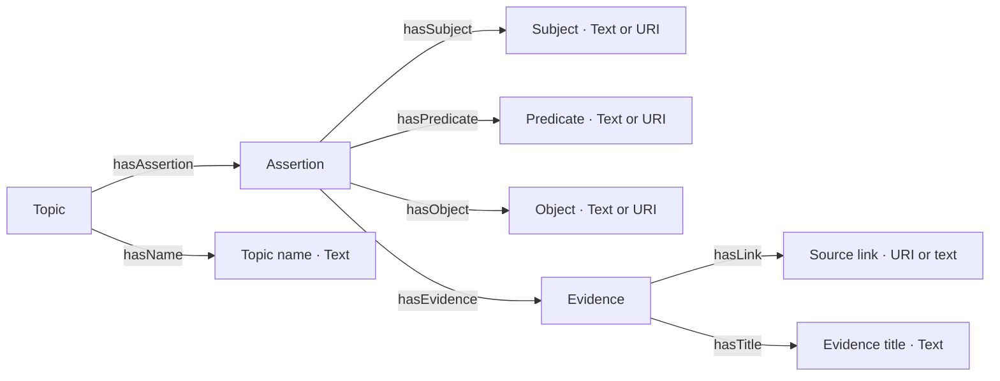

# Agentic AI for Recursive Meteorological Knowledge Exploration and Graph Construction

A research project exploring agentic workflows for recursively discovering meteorological knowledge and organizing connected concepts into inspectable knowledge graphs.

## Project overview

The project focuses on a question-led exploration cycle:

1. Start with a meteorological topic or research question.
2. Retrieve related concepts, entities, and relationships from selected knowledge sources.
3. Use relevant discoveries to guide further exploration, with the scope kept explicit.
4. Build a graph of concepts and evidence-backed connections.

The intended domain spans atmospheric processes, observations, sensors, forecasts, places, time, and related environmental knowledge.

## Methodology structure of the underlying ontology

The model starts with **Topic** resources and connects each topic to one or more explicit **Assertion** resources. An assertion records the subject, predicate, and object of a meteorological knowledge statement, then links to **Evidence** so that its source can be inspected. Topic names and evidence titles provide readable labels; evidence links point to the corresponding source.

The [UN Meteorology triplets workbook](TOPICS/UN_METEOROLOGY_TRIPLETS.xlsx) contains the topic triplets used to inform this domain structure.

## Website

The public project overview is published at:

https://pasangunasekara29.github.io/Agentic-AI-for-Recursive-Meteorological-Knowledge-Exploration-and-Graph-Construction/

## Repository status

This repository was recreated after the previous repository was deleted. GitHub currently shows no recoverable deleted repository, so the former source code and data could not be restored. The repository currently contains the project overview website and its GitHub Pages publishing workflow; add the implementation and research assets from a backup when available.

## License

No license has been selected for the recreated repository yet.
